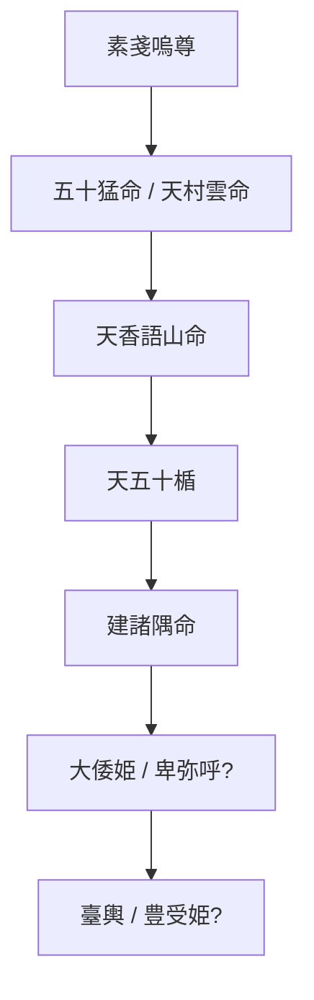

# 3. スサノオと海部氏（あまべし）の系譜

「海部氏勘注系図」に基づき、スサノオから大倭姫に至る阿波の重要系譜。なお、大倭姫を卑弥呼と同定するのは仮説であり未検証である（下記「仮説的同定」節参照）。

## 仮説的同定（「?」付き・未検証）

系図中の「?」は、その同定が仮説であることを示す。いずれも一次史料による裏付けが確認されておらず、未検証の仮説として提示するものであって、確定した事実ではない。

- **大倭姫＝卑弥呼**（図中「大倭姫 / 卑弥呼?」）：「海部氏勘注系図」の大倭姫を卑弥呼と同一視する仮説。同定の根拠は系図の解釈にとどまり、未検証である。
- **臺輿＝豊受姫**（図中「臺輿 / 豊受姫?」）：臺輿を豊受姫と同一視する仮説。同様に未検証である。

---

---
*※本稿は[[阿波説・詳細系譜図集]]から詳細化・分割された専門論考である。*

## 改訂記録

- 2026-11-19：最終判断ラウンド第120件（本人決定）により、系図中の「?」付き同定（大倭姫＝卑弥呼、臺輿＝豊受姫）を仮説として明示し、「仮説的同定（「?」付き・未検証）」節に項目化した。あわせて冒頭文の大倭姫＝卑弥呼の言及に、仮説であり未検証である旨を明記した。
