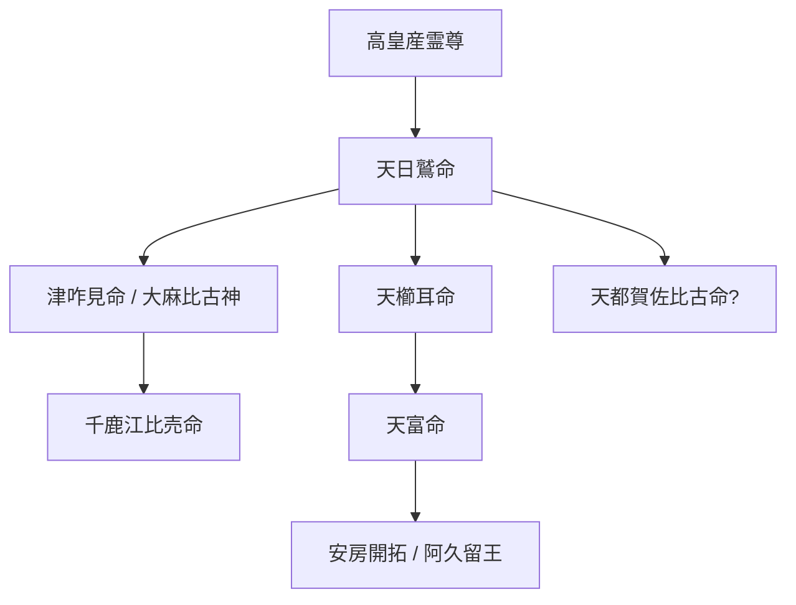

# 1. 忌部氏（いんべし）の系譜

阿波忌部は、高皇産霊尊から始まり、天日鷲命を経て日本全国の開拓へと繋がる。

## 仮説的同定（「?」付き・未検証）

系図中の「?」は、その位置付けが仮説であることを示す。一次史料による裏付けが確認されておらず、未検証の仮説として提示するものであって、確定した事実ではない。

- **天都賀佐比古命の系譜位置**（図中「天都賀佐比古命?」）：天日鷲命の子とする系譜上の位置付けは不確実であり、仮説として提示する。
- **阿久留王**（図中「安房開拓 / 阿久留王」）：伝説的人物とされ、その実在および天富命との系譜関係は未検証である。

---

---
*※本稿は[[阿波説・詳細系譜図集]]から詳細化・分割された専門論考である。*

## 改訂記録

- 2026-11-19：最終判断ラウンド第120件（本人決定）により、系図中の「?」付き同定（天都賀佐比古命の系譜位置）を仮説として明示し、「仮説的同定（「?」付き・未検証）」節に項目化した（伝説的人物とされる阿久留王の扱いも同節に併記）。
